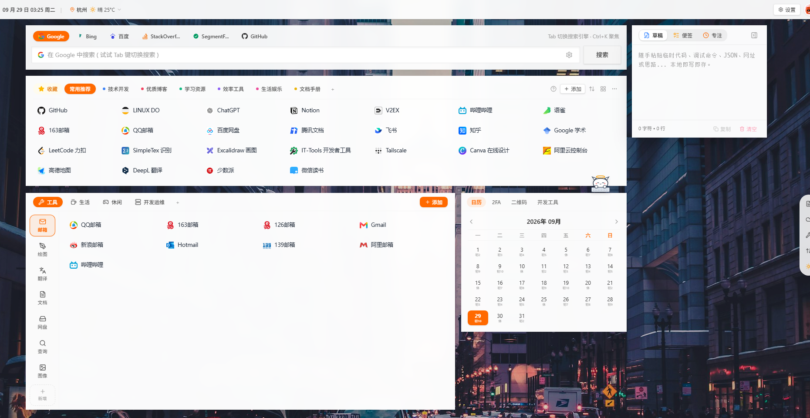

# nav

<p align="left">
  <a href="https://github.com/LosLiSang/nav/releases"></a>
  <a href="https://github.com/LosLiSang/nav/actions/workflows/deploy.yml"></a>
  
  
  
  
  
  
  
</p>

本地优先（Local-First）、现代化个人专属浏览器起始页与生产力工作台。

### 独立工作台同步（#23）

如果前端先发布而 Worker 尚未升级，新接口 404 时会明确显示“需要后端升级”，
并暂停所有整页上传（强制上传也不能绕过），避免不含便签的新快照覆盖旧云端便签。
旧快照中的便签只读补入本机且不会覆盖已有编辑或删除墓碑；本机新增便签、草稿和
书签继续保留。完成后端迁移/发布并重试后，再恢复新协议上传。这是发布保护，
不代表旧后端已具备独立工作台同步能力。

便签使用 `/api/memos?since=...` 增量读取，单条 `PUT/DELETE /api/memos/:id` 写入；
草稿使用 `/api/clipboard` 成为同账号的共享剪贴板。两者都不再进入 `/api/data`
的整页快照，不因编辑书签产生整页便签冲突。仅 active 账号可访问本人数据。

本机改动先落 IndexedDB，离线/失败保留 dirty 队列；自动同步暂停时只保存本地，
手动同步仍可提交。重新获得焦点、页面可见或网络恢复时读取更新。草稿沿用 400ms
防抖，所有写入使用服务端版本 CAS；工作台标签栏用一个云图标表示同步状态（黄色同步中、
红色失败/冲突/待升级、绿色成功、灰色尚未同步），点击图标展开详情与处理入口。冲突保留本机输入，在工作台或设置中显式选择
保留本机/采用云端，服务端删除墓碑不会被旧设备复活。旧快照便签首次读取时事务导入，
原快照备份在 `workbench_migrations`，已有记录及墓碑不会被迁移覆盖。旧本机记录
只导入缺失项；旧草稿与已有云端不同会提示冲突。导入之前必须先部署迁移
`worker/migrations/0003_workbench.sql`；旧客户端上传含 memos 快照会收到升级提示，
不会重新覆盖独立便签。

同步端到端验证只运行在本地隔离数据库。启动 Worker 时使用
`--persist-to <独立测试目录>`，运行 `npm run smoke:sync` 时设置同一绝对路径的
`D1_STATE`，并通过 `APP_URL` / `WORKER_URL` 指定本地服务；Worker 的
`ALLOWED_ORIGIN` 必须包含测试页面 origin。脚本拒绝远程地址和未指定隔离目录的运行，
输出 `artifacts/sync-e2e/report.json`，不会重置现有开发或生产数据库。

<p align="center">
  
</p>

---

## 💡 About (关于本项目)

**nav** 是一款为开发者与知识工作者打造的高颜值、高定制、隐私安全的现代化浏览器导航站与个人工作台。

### 核心设计哲学

- **本地优先 (Local-First)**：所有分类、书签、草稿、待办与个性化外观配置默认完整保存在浏览器本地的 IndexedDB（基于 Dexie 驱动，库名 `nav-workspace-v2`）。无需注册、无需开箱连接后端即可离线流畅使用，零第三方跟踪与隐私收集，冷启动毫秒级加载。
- **优雅视觉体系**：采用现代化半透明磨砂毛玻璃卡片（Backdrop Blur）、深浅色主题无缝切换、多列书签网格、壁纸模糊度/遮罩调节，以及支持十六进制色值的「全局主题高亮色」，兼具观赏性与高密度实用性。
- **常驻生产力工作台 (Persistent Workbench)**：桌面端右侧配备常驻工作面板，内置可随内容自动撑高的即时草稿板、待办清单与番茄专注钟，让导航页从单纯的“网站目录”升维为日常开机即用的工作中枢。
- **坚固而轻量的云同步**：提供开箱即配的 Cloudflare Worker + D1（托管 SQLite）云端服务。基于原子快照与乐观并发冲突控制，换设备或多端办公时仅凭一个密钥即可一键秒级恢复，拒绝静默覆盖。

---

## ✨ 核心特性

- 🗂️ **书签与多级体系**：支持主分类自由添加与拖拽排序、下级分组与二级子分类、书签跨分类拖拽重排与批量管理。
- 🌐 **网站图标智能抓取与本地缓存**：内置多源 Favicon 解析策略与 Worker 后端代理，抓取成功后以 Blob 缓存在本地 IndexedDB。支持按分区、书签组或单个书签清理缓存，随后立即重新获取并更新显示。
- 🔍 **多引擎即时搜索**：聚合 Google、Baidu、Bing、GitHub、DuckDuckGo 等搜索引擎，支持快捷键切换。
- 📝 **自适应草稿板 (Scratchpad)**：临时代码、调试命令、JSON 片段随手暂存；文本框随输入内容自动向下平滑撑高，单层滚动条与卡片自然贴合，支持一键快速复制全文与清空。
- ⏱️ **番茄钟专注**：工作/短休/长休时长均可自定义（1-120 分钟），阶段结束自动衔接下一阶段，长休间隔可配置（默认每 4 个番茄）；「专注设置」弹窗集中管理时长、结束提醒与音量，联动待办事项一键开启专注。
- 🔐 **TOTP / 2FA 二次验证口令**：纯前端安全计算生成 6 位动态验证码，关键账号安全凭证全由本地掌控。
- 🎨 **深度外观定制**：支持自定义网络或本地壁纸、卡片宽度、背景透明度、模糊度、字体族、图标圆角以及全局主题高亮强调色。

---

## 🧹 本地图标缓存维护

服务端缓存与联合刷新仍处于 RFC 设计阶段；见
[待确认方案与完整 E2E 失败矩阵](docs/cache-rfc-proposal.md)。这些文档不代表 #10 / #12 已实现或已批准。
安全边界基线可用 `node scripts/probe-metadata-boundary.mjs` 重复验证，报告位于
`artifacts/metadata-boundary/report.json`；当前基线预期失败，不能当作通过的验收。

在「全局设置 → 界面与壁纸」或「书签展示与排版 → 分类与维护」点击「清理本地图标缓存」：

- 默认选择**主分区当前页的空图标书签**，可逐层调整范围或选择全部书签。
- 「仅空图标」处理没有有效远程图标且未手动指定图标的书签；有效的本地远程图标缓存不算空图标，占位图标不算有效远程图标。
- 图标缓存按域名共享，预览会提示未选中书签的关联影响；不会删除书签、手动图标、保存的标题或同步配置。
- 清理后立即正常获取图标、更新缓存与渲染，支持单独重试失败项。不会删除服务器缓存，正常请求可能命中浏览器/服务器缓存。
- 当前操作仅同步更新本页面的内存状态，其他已打开标签页重新加载后读取最新本地缓存。

### 验证缓存逻辑

纯逻辑测试使用 Node.js 24 的 TypeScript 类型剥离能力，无需启动服务：

```bash
npm run check:cache
```

在已有标题/图标抓取主流程中追加了缓存选择、局部清理、数据保护与失败重试断言；本地夹具模式不会访问线上 Worker，也不等同于验证线上抓取能力：

```bash
npm run check:title:local
```

该主流程自动启动本地服务，默认使用 Windows Edge；可通过 `EDGE_PATH` 指定兼容 Chromium 的浏览器可执行文件。

---

## 📝 便签正文、编辑与网址

在右侧工作台「便签」中：

- **完成状态**只由左侧圆点切换，单击正文不会勾选；正文可正常选择和复制。
- **双击正文**或点击悬停操作区的「编辑」图标进入编辑。输入框自动增高；Enter 保存、Esc 取消、Shift+Enter 换行，失焦也会保存。中文输入法确认时的 Enter 不会误提交。
- 保存空白内容视为取消，不删除便签；保存失败会保留当前输入并提示重试。编辑保留原 ID、创建时间和完成状态，仍走现有 IndexedDB 与整页同步快照链路（本期不实现 #23 的独立待办接口）。
- 文本含有效 `http(s)://` 地址时，操作区显示「打开」图标，点击在新标签页打开第一个地址，并使用 `noopener noreferrer` 隔离；正文不会变成链接，以免影响选中文字。普通文本、`javascript:` 和 `data:` 不显示入口。
- 编辑控件及帮助文字会随整行滚入列表可见区域；操作区也支持键盘聚焦后显示。

验证命令沿用 `npm run check:sidebars`。现有侧边栏流程已追加正文误触、编辑/取消/空白/失焦、输入法、多行、失败重试、保存去重、勾选竞争、删除竞争、真实新标签页隔离、明暗主题对比度和刷新持久化断言，并输出 `artifacts/sidebars-e2e/report.json` 与编辑截图。云同步只验证编辑结果进入现有快照，不以此声称已实测线上账号上传或跨设备恢复。

---

## 🔔 番茄钟结束提醒

右侧工作台「专注」支持工作、短休和长休完成提醒：

- **默认页面提示**：完成时显示当前与下一阶段，提示持续到关闭或切换/重置计时；不会自动启动下一阶段。切换草稿、便签或折叠侧栏后仍可看到提示。
- **可选声音**：在「结束提醒」主动开启后，支持试听和 0–100% 音量调节。浏览器限制声音时会显示降级说明，不阻断页面提示。
- **可选系统通知**：仅主动勾选时请求权限；已经拒绝时不会重复请求。点击通知尝试聚焦页面并打开专注工作台。调用成功不代表操作系统实际送达，系统免打扰等可能抑制提醒。
- **后台标题**：后台完成时在标签页标题显示阶段名称；恢复可见或关闭提示后还原标题。
- **可靠性与边界**：倒计时使用结束时间校正，恢复焦点/可见时重新检查；每次计时完成只提醒和统计一次。暂停、重置、切换阶段会取消旧计时；关闭页面或隐藏整个工作台会终止计时。刷新不恢复运行状态，也不补发过期提醒。各标签页独立计时，不共享运行状态。
- **本设备偏好**：声音、通知和音量按本设备/账号存储，不进入整页云同步；后台冻结、设备休眠或修改系统时间可能影响提醒时机，不承诺后台准时或关闭页面后提醒。
- **移动端范围**：首期沿用桌面右侧工作台入口；窄屏只保证已启动计时的页面提示可见，不新增移动端计时入口。

### 侧边栏端到端回归（Issue #8）

```bash
npm run check:sidebars
```

使用 Node.js 22+、本地 Vite 和独立临时 Edge profile（可通过 `EDGE_PATH` 指定 Chromium 兼容浏览器）。在原有草稿/便签/侧栏/主题流程中追加番茄钟测试：专注设置弹窗与自定义时长、自动阶段衔接、恢复事件去重、暂停续跑、重置/切换取消、声音与音量、通知权限与失败降级、标题恢复、刷新规则、窄屏边界。

测试驱动真实应用、DOM 和计时逻辑，通过推进浏览器内 `Date.now()` 避免实际等待完整阶段时长；AudioContext 和 Notification 使用可控浏览器 API 夹具，因此**不等同于实测扬声器声音、操作系统通知送达或真实设备休眠**，这些需要在目标设备人工验收。输出 `artifacts/sidebars-e2e/report.json` 与明暗主题、窄屏完成提示截图；`OUT_DIR` / `APP_PORT` 可覆盖输出目录和本地端口。

---

## 🚀 前端部署教程 (Frontend)

前端项目基于 **React 19 + TypeScript + Vite + Tailwind CSS v4** 构建，产物为纯静态文件，支持部署到任意静态托管服务。

### 1. 本地开发与调试

确保本地已安装 Node.js (推荐 v20+)：

```bash
# 安装项目依赖
npm install

# 启动本地开发服务器（默认端口 5173）
npm run dev
```

浏览器打开 `http://127.0.0.1:5173` 即可实时预览并支持热重载（HMR）。

#### 主题端到端回归（Issue #22）

```bash
npm run check:light
```

脚本自动启动本地 Vite 和独立临时 profile 的无头 Edge，不使用现有浏览器数据，也不访问线上账号。默认测试端口为 `5202` / `9442`，可用 `APP_PORT` / `DEBUG_PORT` 覆盖；通过 `EDGE_PATH` 指定 Chromium 兼容浏览器。

覆盖 1280px / 390px 两种宽度、系统与应用的深浅色四种组合，以及 9 个弹窗/选项卡，共 72 个场景。断言应用 `color-scheme`、弹窗前景/背景、默认文字与字数统计对比度、完成按钮颜色、滑块轨道和填充、键盘操作与刷新后的持久化；截图和 JSON 报告保存在 `artifacts/light-mode/`，可用 `OUT_DIR` 指定其他目录。报告中的 `lowContrastText` 是其他辅助文字的扫描线索，不代表全站 WCAG 合规检查。

### 2. 静态产物构建

```bash
npm run build
```

构建完成后，可在项目根目录生成 `dist/` 文件夹，该文件夹可直接作为 Web 根目录静态托管。

### 3. 部署到 GitHub Pages (推荐自动化)

本项目已内置完整的 GitHub Actions 工作流（见 [.github/workflows/deploy.yml](.github/workflows/deploy.yml)），支持**双分支流水线**：

1. 在 GitHub 仓库设置中开启 Pages：
   - 进入仓库 **Settings → Pages**；
   - **Build and deployment** 的 Source 选择 **GitHub Actions**。
2. 推送代码触发自动构建：
   - 推送到 `main` 分支：自动打包发布至主站根路径 `https://<你的用户名>.github.io/<仓库名>/`（生产环境）；
   - 推送到 `dev` 分支：自动打包发布至预览路径 `https://<你的用户名>.github.io/<仓库名>/dev/`（测试预览环境）。

### 4. 部署到 Vercel / Cloudflare Pages / 自建 Nginx

- **Vercel / Cloudflare Pages**：
  - Framework Preset：`Vite`
  - Build Command：`npm run build`
  - Output Directory：`dist`
- **Nginx**：
  - 将 `dist/` 内容拷贝至网站目录，配置 `try_files $uri $uri/ /index.html;` 即可。

---

## ☁️ Worker 数据库与 API 部署教程 (Backend)

云端数据同步服务位于 [worker/](worker/) 目录，基于 **Cloudflare Workers** 无服务器函数与 **Cloudflare D1**（边缘托管 SQLite 数据库）构建。

### 1. 架构与数据存储机制

- **存储模型**：采用单表单行快照模型（`nav_docs` 表，行 ID 固定为 `'default'`），整份导航快照（包含分类、书签、备忘录、TOTP、外观设置）序列化为单行 JSON。
- **为什么是单行快照**：前端本地拥有完整的状态和离线操作能力，单行快照能做到原子覆盖，无需两端维护复杂的双向增量 diff，几百条书签约 100~300KB，远低于 D1 单行 2MB 限制。
- **图标缓存隔离**：体积庞大的网站图标（Base64 缓存）刻意留在浏览器本地 IndexedDB，不上传云端，保证云同步毫秒级完成。
- **并发冲突防护 (Optimistic Locking)**：写入时携带客户端基于的版本号 `expectedUpdatedAt`，若服务端在此期间已被其他设备更新则返回 `409 Conflict`，前端弹窗提示由用户选择保留云端还是强制覆盖，彻底杜绝多端静默覆盖。

### 2. 一次性部署步骤

进入 `worker/` 目录执行以下步骤（前 4 步仅需首次配置）：

```bash
cd worker

# 1. 安装 Wrangler 命令行工具
npm install

# 2. 登录并授权 Cloudflare 账号（会唤起浏览器完成登录）
npx wrangler login

# 3. 创建 D1 数据库
npx wrangler d1 create nav-sync
```

执行完第 3 步后，终端会输出一段类似配置：

```toml
[[d1_databases]]
binding = "DB"
database_name = "nav-sync"
database_id = "xxxxxxxx-xxxx-xxxx-xxxx-xxxxxxxxxxxx"
```

将返回的实际 `database_id` 替换填入 `worker/wrangler.toml` 文件中。

```bash
# 4. 在远程 D1 数据库执行表结构初始化
npx wrangler d1 migrations apply nav-sync --remote

# 5. 配置安全的云同步鉴权密钥 (SYNC_TOKEN)
# 提示输入时粘贴一个长随机字符串（建议在前端设置面板点「生成随机 Token」获取）
npx wrangler secret put SYNC_TOKEN

# 6. 部署 Worker 到 Cloudflare 边缘节点
npx wrangler deploy
```

部署完成后，终端将输出你的 Worker 服务公网地址，格式如：

```text
https://nav.<你的账号子域名>.workers.dev
```

### 3. 前端绑定云同步

1. 打开导航页，点击右上角设置图标（齿轮）进入「全局设置」；
2. 切换至「云端同步」选项卡；
3. 填入刚才部署的 Worker 地址（如 `https://nav.xxx.workers.dev`）以及设置的 `SYNC_TOKEN`；
4. 点击「测试连接并保存」，状态亮起绿灯即表示云同步服务已成功连通。

### 4. 本地模拟与日常运维

```bash
# 在本地环境模拟 D1 数据库开发
npm run db:init:local
npm run dev # 启动本地 Worker 调试，默认监听 http://127.0.0.1:8788

# 查看远程数据库数据状态
npx wrangler d1 execute nav-sync --remote --command "SELECT id, updated_at, rev, updated_by, length(doc) as doc_len FROM nav_docs"

# 查看线上实时请求日志
npx wrangler tail

# 轮换同步密钥（轮换后所有使用中的设备需在设置面板同步更新）
npx wrangler secret put SYNC_TOKEN
```

---

## 📡 API 接口规范 (API Reference)

所有对云端快照的读写操作均需要通过 HTTP Authorization 请求头携带 Bearer Token 进行鉴权：

```http
Authorization: Bearer <SYNC_TOKEN>
```

| 请求方法 | 路径 | 鉴权要求 | 说明 |
| :--- | :--- | :---: | :--- |
| **GET** | `/` | 否 | 健康检查，返回服务状态及是否已配置云端 Secret |
| **GET** | `/api/data` | **是** | 获取云端导航页快照数据 `{ ok, doc, updatedAt, rev }` |
| **PUT** | `/api/data` | **是** | 提交导航数据快照（包含版本并发校验与乐观锁判定） |
| **GET** | `/api/icon` | 否 | 智能提取/代理指定域名的网站 Favicon 图标 |
| **GET** | `/api/title` | 否 | 解析并抓取目标 URL 的网页标题（支持 og:title 与 twitter:title 回退） |

### 快照更新请求示例 (`PUT /api/data`)

```json
{
  "doc": {
    "categories": [...],
    "subSections": [...],
    "subCategories": [...],
    "bookmarks": [...],
    "memos": [...],
    "totpAccounts": [...],
    "settings": {...}
  },
  "updatedAt": 1790615118893,
  "expectedUpdatedAt": 1790610000000,
  "force": false
}
```

---

## 📄 开源协议

本项目采用 MIT License 开源许可协议。
